# 📘 Panduan Ringkas Alur UML Sistem Monitoring Ayam Broiler

Dokumen ini dibuat ringkas dan praktis agar kamu bisa langsung menggambarnya ke **Draw.io**, **StarUML**, atau kertas tugas/laporan.

---

## 👥 1. Aktor Sistem
1. **Petugas ABK / Admin**: Mengelola data kandang, periode batch, dan mencatat laporan harian kandang.
2. **Pemilik / Manajemen**: Memantau dashboard performa (KPI & grafik), menerima peringatan kematian, input bobot panen (hitung FCR & IP), dan cetak laporan.

---

## 📌 2. Use Case Diagram (5 Use Case Utama & Cabangnya)

Sistem memiliki **5 Use Case Utama** (terhubung langsung ke Aktor dengan garis lurus), yang kemudian menjorok/bercabang ke oval-oval spesifik menggunakan relasi `<<include>>` (wajib) dan `<<extend>>` (kondisional):

### 5 Use Case Utama:
1. **(UC-01) Login Sistem** *(Aktor: ABK & Pemilik)*
2. **(UC-02) Input Laporan Harian** *(Aktor: Petugas ABK)*
3. **(UC-03) Monitoring Dashboard Eksekutif** *(Aktor: Pemilik)*
4. **(UC-04) Input Bobot Panen & Tutup Batch** *(Aktor: Pemilik)*
5. **(UC-05) Cetak Laporan Produksi** *(Aktor: Pemilik)*

---

### Pemetaan 5 Bundaran Utama ke Oval Cabang:
| No | 5 Bundaran Utama | Oval Cabang (Menjorok) | Tipe Relasi | Keterangan |
|---|---|---|---|---|
| **1** | **Login Sistem** | Verifikasi Kredensial & Role | `<<include>>` | Sistem selalu memeriksa username, hash password, dan role |
| | | Tampil Pesan Gagal Login | `<<extend>>` | Hanya muncul jika password salah atau akun nonaktif |
| **2** | **Input Laporan Harian** | Kalkulasi Hari ke-X & Rekomendasi Pakan | `<<include>>` | Otomatis terhitung dari selisih tanggal DOC masuk |
| | | Validasi Duplikasi Laporan | `<<extend>>` | Menolak jika tanggal pada batch yang sama sudah diisi |
| **3** | **Monitoring Dashboard** | Tampil 6 Grafik Analitik Kinerja | `<<include>>` | Memuat grafik bobot, tren mortalitas, mikroklimat, dll |
| | | Peringatan Kematian (Early Warning) | `<<extend>>` | Hanya muncul jika mortalitas harian $\ge$ 1% populasi |
| **4** | **Input Bobot Panen** | Hitung Otomatis FCR & Indeks Prestasi (IP) | `<<include>>` | Menghitung rumus efisiensi panen setelah bobot riil diisi |
| **5** | **Cetak Laporan Produksi** | Generate Dokumen Kop PT BTS & Kolom TTD | `<<include>>` | Menyiapkan lembar resmi siap print/simpan PDF |

---

### Visual Use Case Diagram (5 Bundaran Utama & Cabangnya):

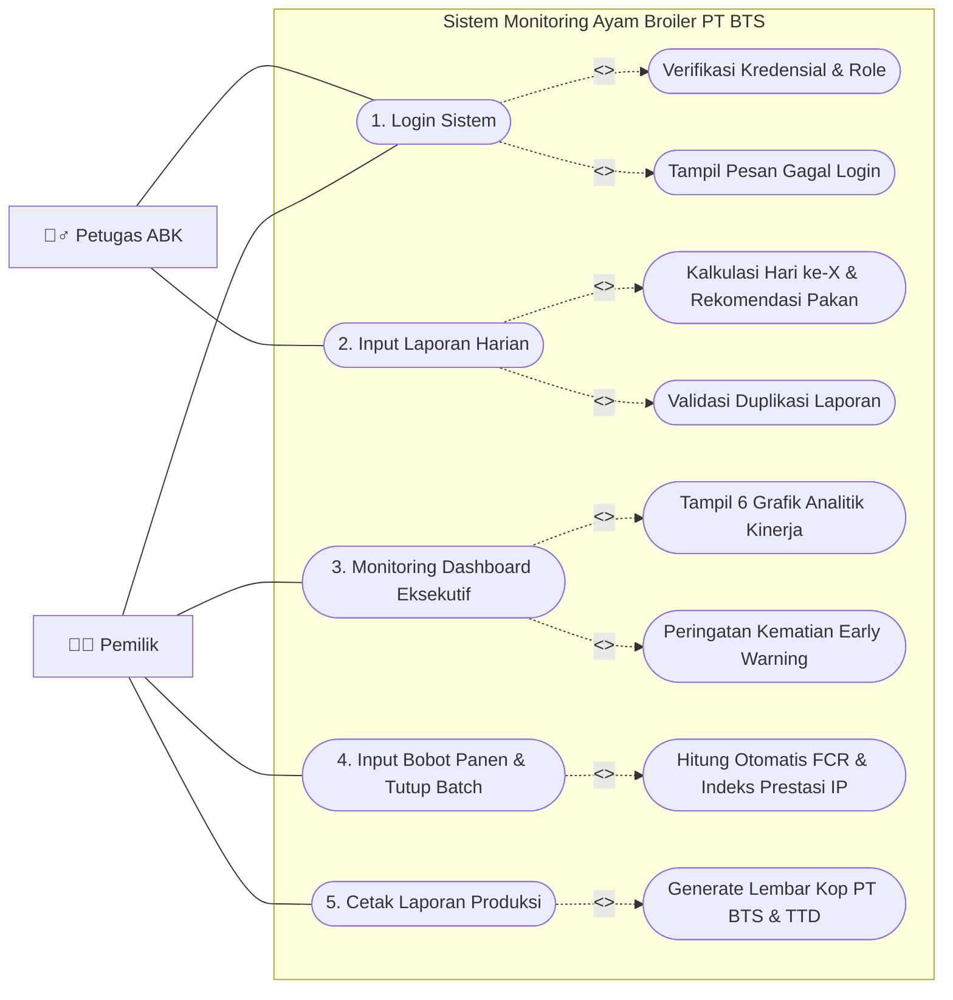

---

## 🔄 3. Activity Diagram (Model 2 Kolom Swimlane: Aktor & System)

> **Format ini dibuat persis sesuai model yang kamu lampirkan** (Kolom Kiri: **Aktor**, Kolom Kanan: **System**).

```
Simbol yang Digunakan:
● (Lingkaran Hitam)       = Titik Mulai (Initial State)
[Teks Aktivitas]          = Kotak Aktivitas (Action State)
<> (Belah Ketupat)        = Pilihan / Percabangan (Decision)
(●) (Lingkaran Berbingkai)= Titik Selesai (Final State)
```

---

### 3.1 Activity Diagram 1: Login Sistem

| Pengguna (ABK / Pemilik) | System |
| :--- | :--- |
| ● *(Mulai)* | |
| ↓ | |
| **[Masuk Aplikasi]** | ───► **[Tampil Form Login]** |
| | │ |
| **[Memasukkan Username & Password]** | ◄───┘ |
| │ | |
| └───────────────────────────────► | **< Benar? >** |
| | ├── **Tidak** ──► Kembali ke **[Tampil Form Login]** |
| | └── **Ya** |
| | ↓ |
| | **[Tampil Dashboard / Menu Utama]** |
| | ↓ |
| | (●) *(Selesai)* |

#### Versi Visual Diagram:
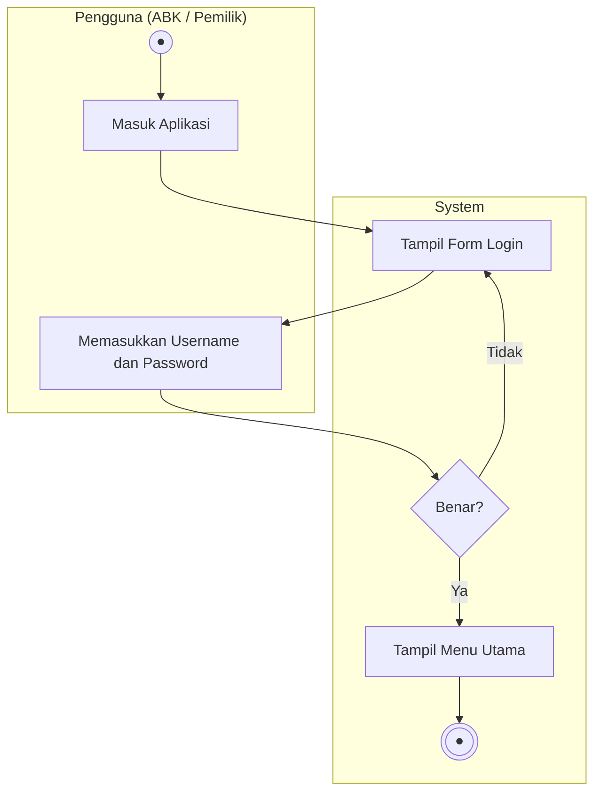

---

### 3.2 Activity Diagram 2: Input Laporan Harian Kandang

| Petugas ABK | System |
| :--- | :--- |
| ● *(Mulai)* | |
| ↓ | |
| **[Pilih Menu Input Harian]** | ───► **[Tampil Form Input Harian]** |
| | │ |
| **[Pilih Batch Periode & Tanggal]** | ◄───┘ |
| │ | |
| └───────────────────────────────► | **[Hitung Otomatis Hari ke-X & Tentukan Jenis Pakan]** |
| | │ |
| **[Input Data Kematian, Pakan, Suhu, & Bobot]** | ◄───┘ |
| │ | |
| **[Klik Tombol Simpan]** | |
| │ | |
| └───────────────────────────────► | **< Data Tanggal Sudah Ada? >** |
| | ├── **Ya** ──► **[Tampil Notifikasi Error Duplikat]** ──► kembali ke Form |
| | └── **Tidak** |
| | ↓ |
| | **[Simpan Data ke Database & Update Sisa Populasi]** |
| | ↓ |
| | **[Tampil Notifikasi Berhasil & Buka Riwayat]** |
| | ↓ |
| | (●) *(Selesai)* |

#### Versi Visual Diagram:
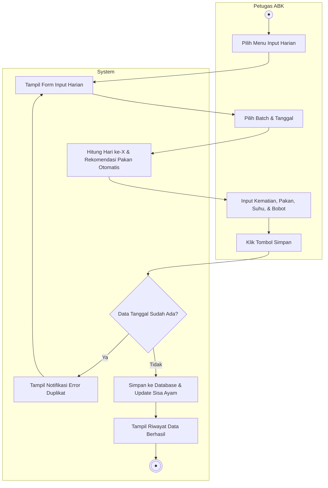

---

### 3.3 Activity Diagram 3: Monitoring Dashboard Eksekutif

| Pemilik | System |
| :--- | :--- |
| ● *(Mulai)* | |
| ↓ | |
| **[Pilih Menu Dashboard]** | ───► **[Ambil Data Periode & Hitung KPI (Mortalitas, FCR, Pakan)]** |
| | ↓ |
| | **[Render 6 Grafik Analitik Kinerja]** |
| | ↓ |
| | **< Kematian Harian >= 1% Populasi? >** |
| | ├── **Ya** ──► **[Tampilkan Banner Early Warning Merah]** |
| | └── **Tidak** ─► **[Tampilkan Status Normal]** |
| | │ |
| **[Melihat Analisis & Evaluasi Kondisi Ayam]** | ◄───┘ |
| ↓ | |
| (●) *(Selesai)* | |

#### Versi Visual Diagram:
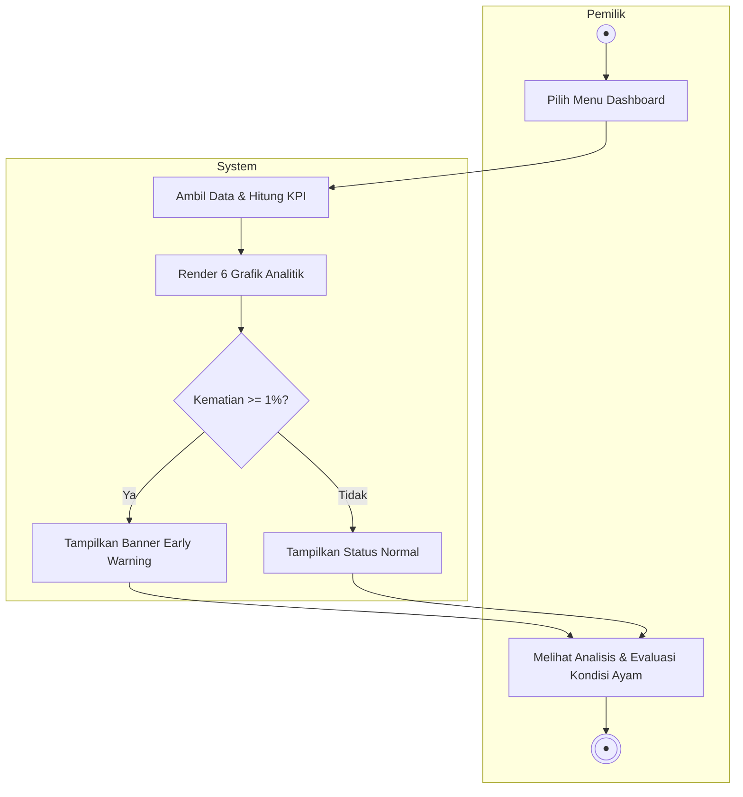

---

### 3.4 Activity Diagram 4: Input Bobot Panen & Perhitungan FCR / IP

| Pemilik | System |
| :--- | :--- |
| ● *(Mulai)* | |
| ↓ | |
| **[Buka Menu Laporan Produksi]** | ───► **[Tampilkan Data Rekap Siklus Pemeliharaan]** |
| | │ |
| **[Buka Modal Tutup Panen]** | ◄───┘ |
| │ | |
| **[Masukkan Total Bobot Panen Riil (Kg)]** | |
| │ | |
| **[Klik Simpan & Selesai Panen]** | |
| │ | |
| └───────────────────────────────► | **[Update Status Batch Menjadi 'Selesai']** |
| | ↓ |
| | **[Hitung Otomatis FCR Final & Nilai Indeks Prestasi (IP)]** |
| | ↓ |
| | **[Tampilkan Hasil Evaluasi Kinerja (Istimewa/Baik/Kurang)]** |
| | ↓ |
| | (●) *(Selesai)* |

#### Versi Visual Diagram:
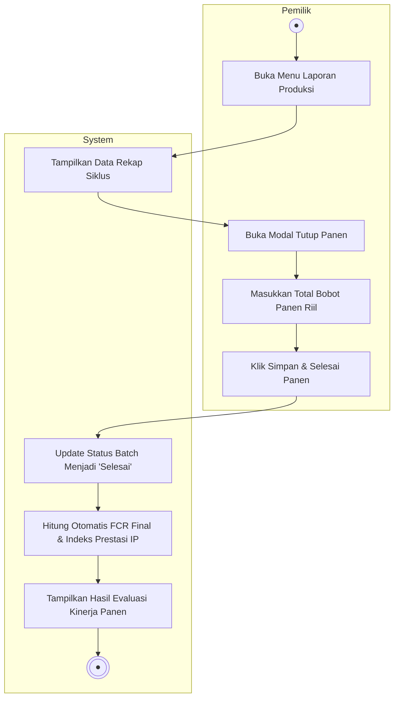

---

### 3.5 Activity Diagram 5: Cetak Laporan Produksi Resmi

| Pemilik | System |
| :--- | :--- |
| ● *(Mulai)* | |
| ↓ | |
| **[Pilih Periode Laporan]** | ───► **[Ambil Data Detail Rekap & Profil Perusahaan]** |
| | │ |
| **[Klik Tombol Cetak / PDF]** | ◄───┘ |
| │ | |
| └───────────────────────────────► | **[Siapkan Format Cetak Resmi (Kop PT BTS & Kolom TTD)]** |
| | ↓ |
| | **[Buka Kotak Dialog Print Browser / PDF]** |
| | │ |
| **[Simpan PDF / Cetak ke Printer]** | ◄───┘ |
| ↓ | |
| (●) *(Selesai)* | |

---

## ⚡ 4. Sequence Diagram (5 Diagram Sesuai 5 Activity Diagram)

Setiap Sequence Diagram memetakan alur: **Aktor $\rightarrow$ Tampilan (View) $\rightarrow$ Controller $\rightarrow$ Database**.

---

### 4.1 Sequence Diagram 1: Login Sistem
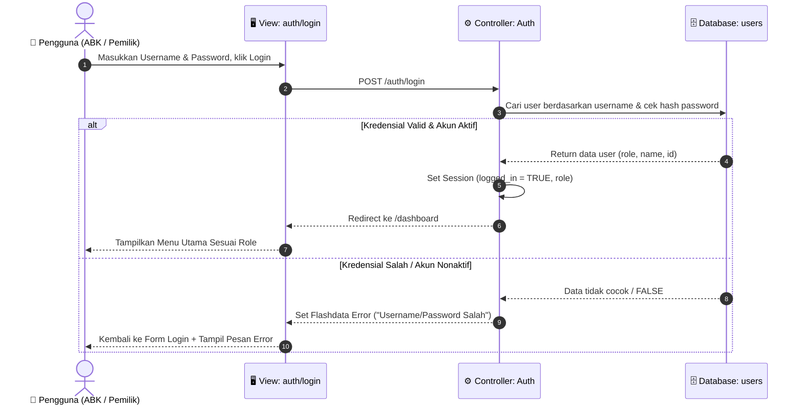

---

### 4.2 Sequence Diagram 2: Input Laporan Harian Kandang
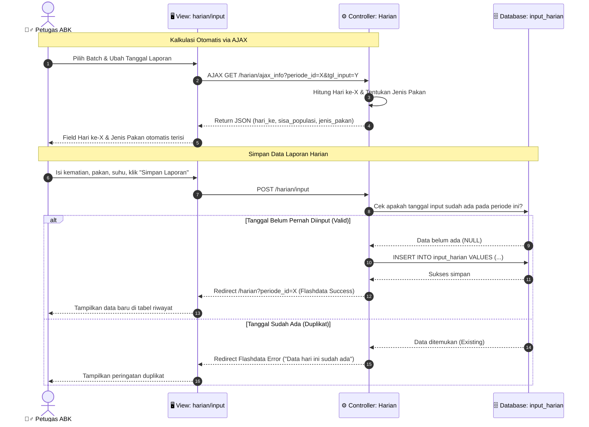

---

### 4.3 Sequence Diagram 3: Monitoring Dashboard Eksekutif
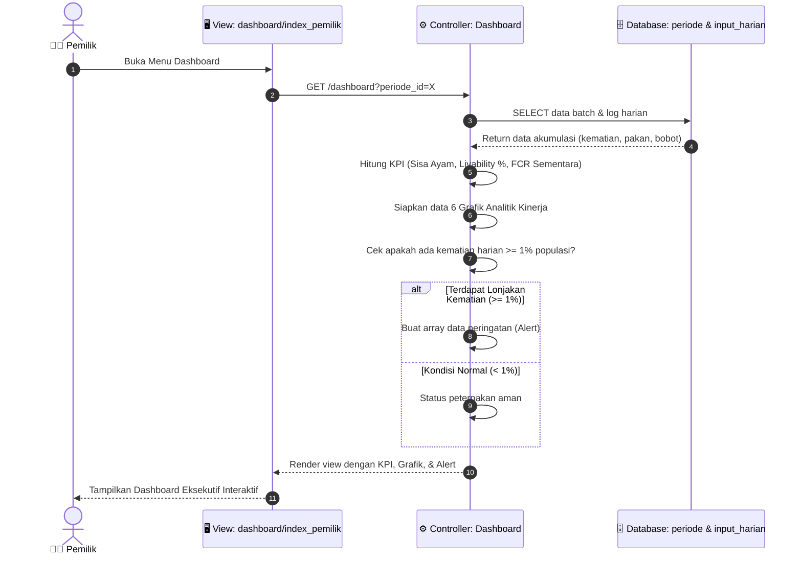

---

### 4.4 Sequence Diagram 4: Input Bobot Panen & Perhitungan FCR / IP
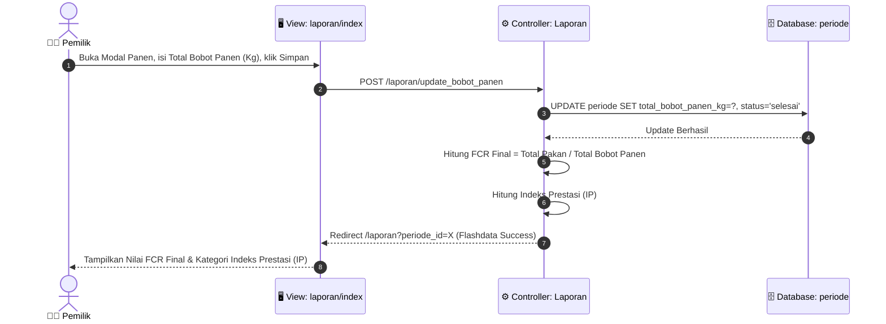

---

### 4.5 Sequence Diagram 5: Cetak Laporan Produksi Resmi
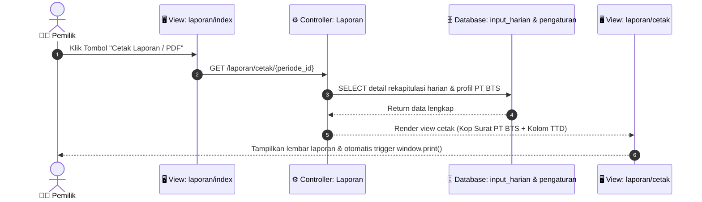


---

## 🏛️ 5. Class Diagram (Format Sesuai Standar UML)

> **Format Kotak Kelas Sesuai Contoh Gambar:**
> - **Kotak Atas**: Nama Kelas (`PascalCase`)
> - **Kotak Tengah (Atribut)**: `- namaVariabel: tipeData` *(Variabel di depan, tipe data di belakang)*
> - **Kotak Bawah (Method/Operasi)**: `+ namaMethod()` *(Fungsi/operasi aksi)*
> - **Relasi Kardinalitas**: `1` ke `1..*` *(One-to-Many)*

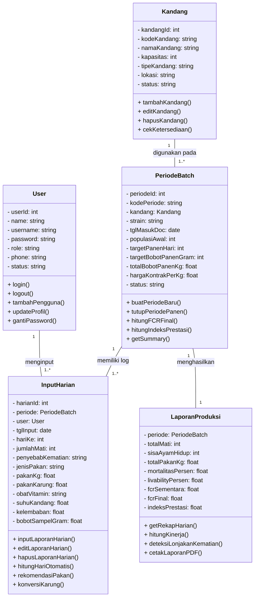

---

### Rincian Teks Kelas untuk Digambar Manual / Draw.io

#### 1. Kelas: `User`
* **Atribut (Kotak Tengah)**:
  - `- userId: int`
  - `- name: string`
  - `- username: string`
  - `- password: string`
  - `- role: string`
  - `- phone: string`
  - `- status: string`
* **Method (Kotak Bawah)**:
  - `+ login()`
  - `+ logout()`
  - `+ tambahPengguna()`
  - `+ updateProfil()`
  - `+ gantiPassword()`

---

#### 2. Kelas: `Kandang`
* **Atribut (Kotak Tengah)**:
  - `- kandangId: int`
  - `- kodeKandang: string`
  - `- namaKandang: string`
  - `- kapasitas: int`
  - `- tipeKandang: string`
  - `- lokasi: string`
  - `- status: string`
* **Method (Kotak Bawah)**:
  - `+ tambahKandang()`
  - `+ editKandang()`
  - `+ hapusKandang()`
  - `+ cekKetersediaan()`

---

#### 3. Kelas: `PeriodeBatch`
* **Atribut (Kotak Tengah)**:
  - `- periodeId: int`
  - `- kodePeriode: string`
  - `- kandang: Kandang`
  - `- strain: string`
  - `- tglMasukDoc: date`
  - `- populasiAwal: int`
  - `- targetPanenHari: int`
  - `- targetBobotPanenGram: int`
  - `- totalBobotPanenKg: float`
  - `- hargaKontrakPerKg: float`
  - `- status: string`
* **Method (Kotak Bawah)**:
  - `+ buatPeriodeBaru()`
  - `+ tutupPeriodePanen()`
  - `+ hitungFCRFinal()`
  - `+ hitungIndeksPrestasi()`
  - `+ getSummary()`

---

#### 4. Kelas: `InputHarian`
* **Atribut (Kotak Tengah)**:
  - `- harianId: int`
  - `- periode: PeriodeBatch`
  - `- user: User`
  - `- tglInput: date`
  - `- hariKe: int`
  - `- jumlahMati: int`
  - `- penyebabKematian: string`
  - `- jenisPakan: string`
  - `- pakanKg: float`
  - `- pakanKarung: float`
  - `- obatVitamin: string`
  - `- suhuKandang: float`
  - `- kelembaban: float`
  - `- bobotSampelGram: float`
* **Method (Kotak Bawah)**:
  - `+ inputLaporanHarian()`
  - `+ editLaporanHarian()`
  - `+ hapusLaporanHarian()`
  - `+ hitungHariOtomatis()`
  - `+ rekomendasiPakan()`
  - `+ konversiKarung()`

---

#### 5. Kelas: `LaporanProduksi`
* **Atribut (Kotak Tengah)**:
  - `- periode: PeriodeBatch`
  - `- totalMati: int`
  - `- sisaAyamHidup: int`
  - `- totalPakanKg: float`
  - `- mortalitasPersen: float`
  - `- livabilityPersen: float`
  - `- fcrSementara: float`
  - `- fcrFinal: float`
  - `- indeksPrestasi: float`
* **Method (Kotak Bawah)**:
  - `+ getRekapHarian()`
  - `+ hitungKinerja()`
  - `+ deteksiLonjakanKematian()`
  - `+ cetakLaporanPDF()`

---

### Garis Relasi & Kardinalitas Antar Kelas:
1. **`Kandang` (`1`) ───────── (`1..*`) `PeriodeBatch`**
   - *Satu unit kandang bisa digunakan berulang kali untuk banyak periode pemeliharaan/batch (1 ke banyak).*
2. **`PeriodeBatch` (`1`) ───────── (`1..*`) `InputHarian`**
   - *Satu batch pemeliharaan memiliki banyak data rekaman harian dari hari ke-1 s/d panen (1 ke banyak).*
3. **`User` (`1`) ───────── (`1..*`) `InputHarian`**
   - *Satu user/petugas ABK dapat menginput banyak catatan laporan harian (1 ke banyak).*
4. **`PeriodeBatch` (`1`) ───────── (`1`) `LaporanProduksi`**
   - *Satu batch pemeliharaan menghasilkan satu rekapitulasi laporan performa produksi akhir (1 ke 1).*

---

## 📐 6. Rumus Utama Sistem (Bila Ditanyakan Dosen/Penguji)
1. **Umur Ayam (Hari ke-X)**: `(Tanggal Laporan - Tanggal Masuk DOC) + 1`
2. **Mortalitas (%)**: `(Total Kematian / Populasi Awal) × 100%`
3. **Livability (%)**: `100% - Mortalitas (%)`
4. **FCR Final**: `Total Pakan Terpakai (Kg) / Total Bobot Panen Riil (Kg)`
5. **Indeks Prestasi (IP)**: `(Livability % × Rata Bobot Panen Kg) / (FCR × Umur Rata Panen) × 100`
6. **Early Warning Alert**: Muncul jika kematian harian $\ge 1\%$ populasi awal.

